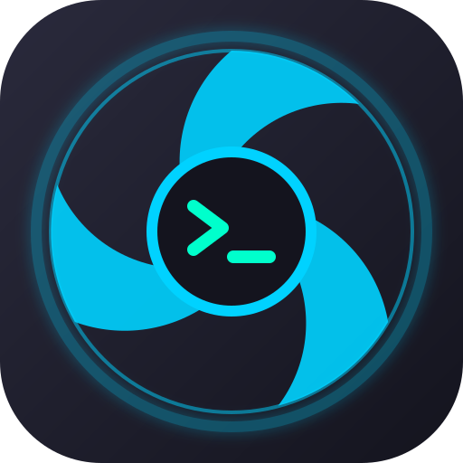

  

<h1 align="center">Prism Linux Control Center</h1>

  Linux RGB and hardware controller with fan control and LCD playback for supported devices.

Prism Linux Control Center combines a desktop GUI and a background daemon. It controls supported Lian Li devices, ASUS Aura lighting, selected ENE memory RGB controllers, and one hardware-verified Gigabyte RTX 4080 lighting controller. Device and feature support varies; see the [compatibility matrix](docs/hardware-compatibility.md).

Prism is founded and led by **Major Riven** and is separately maintained as a derivative of [Lian Li Linux](https://github.com/sgtaziz/lian-li-linux). The project is not affiliated with or endorsed by Lian Li or the other hardware manufacturers named here. Original upstream copyright and MIT notices are retained; see [NOTICE](NOTICE), [source provenance](SOURCE_PROVENANCE.md), and [third-party notices](THIRD_PARTY_NOTICES.md). Prism branding does not imply ownership of upstream work or third-party marks.

## Install

Distribution packages and source installation instructions are in the [installation guide](docs/installation.md). The v1.3.0-beta.1 candidate targets Ubuntu 24.04, Ubuntu 26.04 and Debian 13 on amd64. Packages must be built and checked on their target distribution before use.

The beta package matrix is limited to Ubuntu 24.04/26.04 and Debian 13 amd64. The [Distrobox guide](docs/distrobox.md) describes the existing upstream stable package channel. The [source build guide](docs/building-from-source.md) covers dependencies and compilation.

## Features

- RGB modes and effects for the supported controllers listed in the compatibility matrix.
- Fan and pump controls where a device backend exposes them, including software curves and supported motherboard PWM synchronization.
- LCD media, templates, sensor gauges and desktop display modes on supported panels.
- A GUI and daemon communicating through the existing local IPC interface.

The project does not claim universal support for Linux hardware. Unsupported operations are not inferred from a device appearing in discovery.

## Documentation

- [Hardware compatibility and verification status](docs/hardware-compatibility.md)
- [Installation, upgrade and removal](docs/installation.md)
- [Build from source](docs/building-from-source.md)
- [Known limitations](docs/known-limitations.md)
- [Contributing](CONTRIBUTING.md)
- [License and third-party notices](docs/licensing.md)
- [Acknowledgments](ACKNOWLEDGMENTS.md)
- [Third-party notices and dependency inventory](THIRD_PARTY_NOTICES.md)
- [v1.3.0-beta.1 release notes](docs/releases/v1.3.0-beta.1.md)

## License

Original contributions by Major Riven are licensed under MIT. The original Lian Li Linux notices remain in place, and third-party components retain their own licenses and attribution. Read [LICENSE](LICENSE), [NOTICE](NOTICE), and [the licensing guide](docs/licensing.md) before redistributing.
